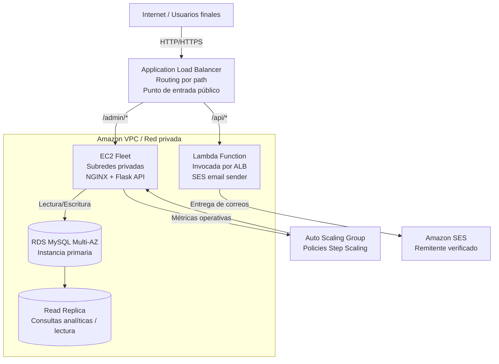

# Sistema de matrícula universitaria en AWS

Proyecto base para desplegar una plataforma de matrícula universitaria altamente disponible con una arquitectura orientada a resiliencia, segmentación de tráfico, integración serverless y acceso de datos con alta disponibilidad.

## Autoría y portafolio

- Portfolio: https://oskar-ortiz.vercel.app
- GitHub: https://github.com/oskar-ortiz

## Visión arquitectónica empresarial



### Principios de diseño
- La entrada pública queda centralizada en el Application Load Balancer.
- La capa de aplicación permanece privada y escalable dentro de la VPC.
- El routing por path separa claramente cargas transaccionales y workloads serverless.
- La durabilidad y la disponibilidad se apoyan en RDS Multi-AZ con estrategia de read replica.
- La solución refleja patrones modernos de AWS para despliegue seguro, resiliente y escalable.

## Estructura del repositorio

```text
.
|-- app/
|   `-- backend/
|-- lambda/
|-- modules/
|   |-- alb/
|   |-- compute/
|   |-- database/
|   |-- network/
|   `-- security/
|-- nginx/
|-- scripts/
|-- main.tf
|-- variables.tf
`-- outputs.tf
```

## Flujo funcional

1. Cliente o panel admin llama `POST /admin/enrollments`.
2. La aplicación en EC2 escribe la matrícula en el endpoint writer de RDS.
3. Las consultas `GET /admin/enrollments` leen desde la Read Replica.
4. Cliente o proceso externo llama `POST /api/confirm`.
5. El ALB invoca Lambda directamente.
6. Lambda envía correo con SES; si falla, reintenta con backoff exponencial hasta 3 veces.
7. Si los 3 intentos fallan, Lambda guarda el error en la tabla `email_failures`.

## Despliegue CLI con PowerShell

1. Empaqueta la Lambda:

```powershell
.\scripts\package_lambda.ps1
```

2. Si la infraestructura ya existe y solo quieres subir cambios al código de Lambda:

```powershell
.\scripts\aws_cli_update_lambda_code.ps1
```

3. Ejecuta el despliegue completo:

```powershell
.\scripts\aws_cli_deploy.ps1 `
  -SesSenderEmail "remitente-verificado@dominio.com" `
  -SesRecipientEmail "destinatario-verificado@dominio.com" `
  -DbPassword "ChangeMe123!"
```

4. Verifica el flujo de aplicación:

```powershell
.\scripts\aws_cli_verify.ps1 -StudentEmail "destinatario-verificado@dominio.com"
```

5. Ejecuta failover controlado:

```powershell
.\scripts\aws_cli_failover_test.ps1
```

## Terraform alternativo

Si prefieres IaC con Terraform, la base también está incluida en este repositorio.

## Endpoints

- `GET /health`
- `GET /admin/health`
- `POST /admin/enrollments`
- `GET /admin/enrollments`
- `POST /api/confirm`

Ejemplo de matrícula:

```bash
curl -X POST "http://ALB_DNS/admin/enrollments" \
  -H "Content-Type: application/json" \
  -d '{"student_name":"Ana Perez","student_email":"verified-recipient@example.com","course_code":"CS101"}'
```

Ejemplo de correo:

```bash
curl -X POST "http://ALB_DNS/api/confirm" \
  -H "Content-Type: application/json" \
  -d '{"enrollment_id":1,"student_name":"Ana Perez","student_email":"verified-recipient@example.com","course_code":"CS101"}'
```

## Pruebas de carga

Desde una EC2 de pruebas:

```bash
chmod +x scripts/load_test.sh
./scripts/load_test.sh ALB_DNS
```

## Explicación breve

### Failover en RDS Multi-AZ

RDS mantiene una instancia standby sincronizada en otra AZ. Si la primaria falla por un problema de infraestructura, almacenamiento o disponibilidad, AWS promueve automáticamente la standby y actualiza el endpoint. El cliente no percibe un corte funcional relevante y la escritura se restaura sin intervención directa.

### Cómo funciona ALB con Lambda

El ALB no abre una conexión TCP hacia Lambda. En su lugar, cuando una regla del listener coincide con `/api/*`, el ALB transforma la solicitud HTTP en un evento JSON e invoca la función Lambda de manera gestionada. Esto permite un modelo serverless para procesamiento de correo sin crear infraestructura adicional en la capa de entrada.

## Notas operativas

- En sandbox de SES, tanto remitente como destinatario deben estar verificados.
- El proyecto usa una sola NAT Gateway para simplificar y abaratar; para HA completa de salida, usa una NAT por AZ.
- La password de RDS se pasa como variable sensible. En producción, mueve esto a Secrets Manager o SSM Parameter Store.
- El despliegue CLI guarda evidencia operativa en `scripts/deployment-output.json`.
